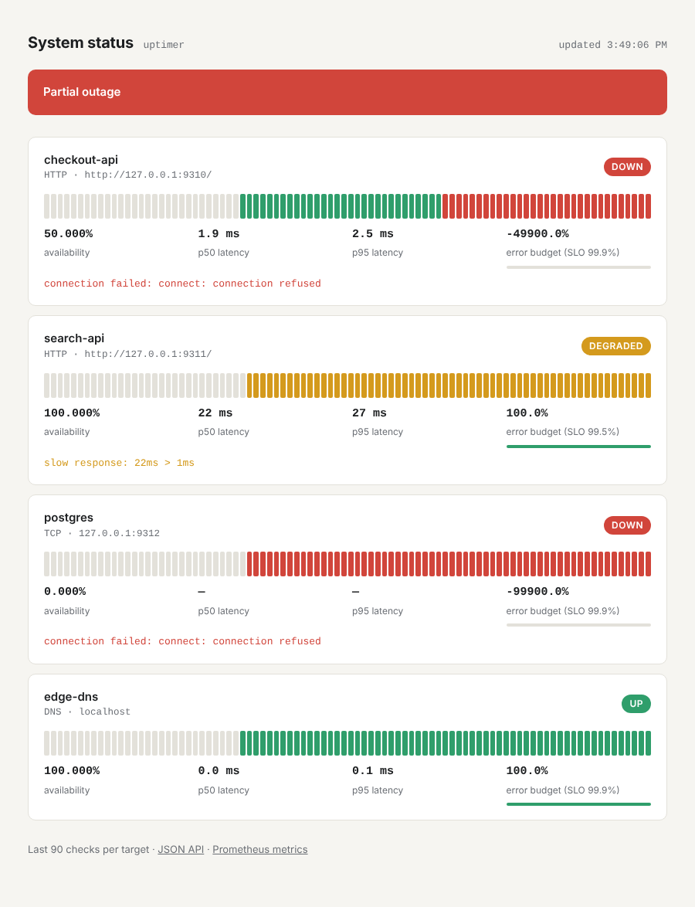
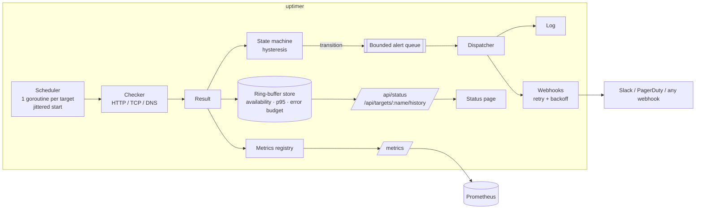

# uptimer

A self-hosted uptime monitor written in Go with **zero third-party dependencies**.
It probes HTTP, TCP and DNS endpoints, runs every result through a flap-resistant
state machine, tracks availability against per-target SLOs and error budgets,
sends alerts to Slack or any webhook, and exposes a live status page and
Prometheus metrics.

```
$ uptimer -config config.json
{"level":"INFO","msg":"uptimer started","version":"v1.0.0","listen":":8080","targets":4}
{"level":"INFO","msg":"status change","target":"payments-api","from":"up","to":"down","reason":"unexpected status 502"}
{"level":"WARN","msg":"alert","target":"payments-api","summary":"🔴 payments-api is DOWN (https://…/health) — unexpected status 502"}
```



## Features

- **Probes** — HTTP(S) (method, headers, expected status codes, body keyword match),
  TCP connect, DNS resolution. Each HTTP probe uses a fresh connection so measured
  latency includes DNS + TCP + TLS, like a real first visit.
- **Hysteresis state machine** — `UNKNOWN → UP ⇄ DEGRADED`, `→ DOWN` only after
  *N* consecutive failures, back up only after *M* consecutive successes. One
  dropped packet doesn't page anyone; a flapping service doesn't spam the channel.
- **Degraded detection** — slow responses (`degraded_latency`) and TLS certificates
  close to expiry mark a target DEGRADED without paging.
- **SLOs and error budgets** — availability, p50/p95/p99 latency and remaining error
  budget per target over a bounded in-memory window.
- **Alerting** — Slack-formatted or generic JSON webhooks, retried with exponential
  backoff on 5xx/429 (never on other 4xx), repeat reminders while a target stays
  down, and a bounded non-blocking queue so a broken webhook can never stall probes.
- **Observability** — `/metrics` in Prometheus exposition format (gauges, counters,
  latency histograms) plus ready-made Prometheus alert rules including a
  multi-window error-budget burn-rate alert.
- **Status page** — embedded in the binary; last 90 checks per target, availability,
  latency and error-budget bars; light and dark mode.
- **Operationally boring** — structured JSON logs, graceful shutdown that drains
  pending alerts, `-validate` for CI, secrets via `${ENV_VARS}` in config,
  distroless non-root container image.

## Architecture



| Package | Responsibility |
|---|---|
| `internal/config` | JSON config, env-var expansion, defaults, validation that reports every error at once |
| `internal/check` | HTTP/TCP/DNS probes; turns raw network errors into short, alert-friendly reasons |
| `internal/monitor` | Per-target scheduling, the state machine, wiring results to store, metrics and alerts |
| `internal/store` | Thread-safe fixed-size ring buffer per target; availability, nearest-rank percentiles, error budget |
| `internal/alert` | Notifier interface, Slack/generic webhooks with retries, non-blocking dispatcher that drains on shutdown |
| `internal/metrics` | Small Prometheus text-format registry (gauge, counter, histogram, label escaping) |
| `internal/server` | Status page (embedded via `go:embed`), JSON API, `/healthz`, `/metrics` |

## Quick start

```bash
# Run locally (Go 1.24+)
make run                      # uses config.example.json, serves http://localhost:8080

# Or the full stack: uptimer + Prometheus with alert rules + a webhook sink
make up                       # http://localhost:8080 (status) · http://localhost:9090 (Prometheus)
docker compose logs -f alert-sink   # watch webhook alerts arrive
```

Validate a config without starting anything:

```bash
uptimer -config config.json -validate
```

## Configuration

```json
{
  "listen": ":8080",
  "history_size": 1440,
  "targets": [
    {
      "name": "payments-api",
      "type": "http",
      "url": "https://api.example.com/health",
      "headers": { "Authorization": "Bearer ${HEALTH_TOKEN}" },
      "expect_status": [200],
      "expect_body_contains": "\"status\":\"ok\"",
      "interval": "30s",
      "timeout": "5s",
      "degraded_latency": "800ms",
      "failure_threshold": 3,
      "recovery_threshold": 2,
      "slo": 99.9
    },
    { "name": "postgres", "type": "tcp", "address": "db.internal:5432", "interval": "15s" },
    { "name": "edge-dns", "type": "dns", "host": "example.com" }
  ],
  "alerts": {
    "repeat_interval": "30m",
    "webhooks": [{ "name": "oncall", "url": "${SLACK_WEBHOOK_URL}", "format": "slack" }]
  }
}
```

| Field | Default | Notes |
|---|---|---|
| `interval` / `timeout` | `30s` / `5s` | timeout is capped at the interval |
| `expect_status` | any 2xx/3xx | list of exact codes when set |
| `degraded_latency` | off | slower successful probes mark the target DEGRADED |
| `cert_expiry_warning` | `336h` (14d) | HTTPS only; DEGRADED when the leaf cert expires sooner |
| `failure_threshold` | `3` | consecutive failures before DOWN |
| `recovery_threshold` | `2` | consecutive successes before a DOWN target is UP again |
| `slo` | `99.9` | percent; drives the error-budget figures |
| `history_size` | `1440` | results retained per target (12h at 30s) |
| `repeat_interval` | off | resend DOWN alerts while a target stays down |

Unknown fields are rejected, so a typo like `"intervall"` fails fast instead of silently using the default.

## HTTP API

| Endpoint | Description |
|---|---|
| `GET /` | Status page |
| `GET /api/status` | Overall status (worst of all targets) plus per-target status, last check and stats |
| `GET /api/targets/{name}/history?limit=100` | Recent results, oldest first |
| `GET /metrics` | Prometheus metrics |
| `GET /healthz` | Liveness |

## Metrics

| Metric | Type | Labels |
|---|---|---|
| `uptimer_up` | gauge | `target`, `type` |
| `uptimer_target_status` | gauge (one-hot) | `target`, `status` |
| `uptimer_check_duration_seconds` | histogram | `target`, `type` |
| `uptimer_checks_total` | counter | `target`, `result` |
| `uptimer_state_transitions_total` | counter | `target`, `to` |
| `uptimer_cert_expiry_timestamp_seconds` | gauge | `target` |
| `uptimer_availability_ratio` | gauge | `target` |
| `uptimer_error_budget_remaining_ratio` | gauge | `target` |
| `uptimer_alerts_dropped_total` | gauge | — |

`deploy/alerts.yml` contains Prometheus rules for target down, fast error-budget
burn (1h and 5m windows at 14.4× the allowed rate), certificates expiring within
14 days, and sustained slow probes.

## Design decisions

- **Hysteresis over raw results.** Alerting on every failed probe produces noise
  that teaches people to ignore alerts. Separate failure and recovery thresholds
  give an asymmetric, flap-resistant signal.
- **Alerts never block probes.** Transitions go into a bounded channel; a slow or
  failing webhook can only delay other alerts, never detection. If the queue is
  full, events are dropped and counted in `uptimer_alerts_dropped_total` so the
  loss is observable rather than silent.
- **Retry only what can succeed.** 5xx, 429 and network errors are retried with
  exponential backoff; other 4xx responses are permanent (bad URL or payload) and
  fail immediately.
- **Shutdown is not an outage.** A probe cancelled by SIGTERM is discarded instead
  of being recorded as a failure, and the alert queue drains after probes stop so
  a transition seen during shutdown is still delivered.
- **Jittered start.** Each target's first probe is offset randomly within its
  interval so many targets don't fire on the same tick.
- **No dependencies.** The standard library covers HTTP, TLS, DNS, JSON,
  structured logging and routing (Go 1.22 method + path patterns). The Prometheus
  text format is small enough to implement and test directly, which keeps the
  binary small and the supply chain empty.

## Testing

```bash
make test     # go test -race ./...
make cover
```

Tests cover every package: table-driven state-machine cases (blips, flapping,
recovery, degraded), HTTP/HTTPS/TCP/DNS probes against local `httptest` servers
and listeners (including timeouts, untrusted certs and cert-expiry warnings),
webhook retry and no-retry paths, queue overflow and drain-on-shutdown, metric
exposition and label escaping, ring-buffer wrap-around and percentile maths, and
an end-to-end test that takes a live target UP → DOWN → UP and asserts the exact
alerts and metrics produced.

## Roadmap

- Persist history (SQLite or Postgres) so SLO windows survive restarts
- Multi-region probing with quorum before declaring DOWN
- Hot config reload on SIGHUP
- gRPC health-check and ICMP probes

## License

MIT © Rishi Vyas
